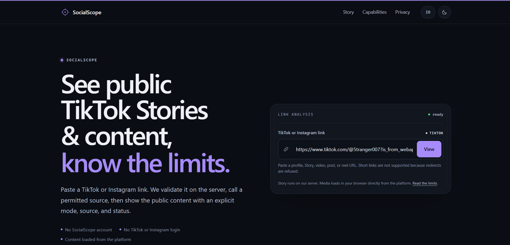
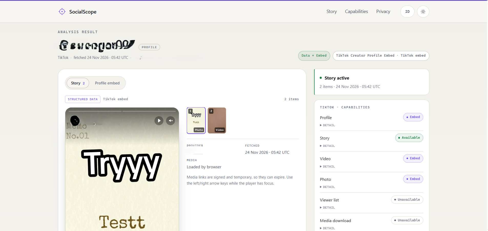

# SocialScope

SocialScope is a capability-honest public content viewer for TikTok and Instagram. Paste a public URL and SocialScope shows only what the selected surface actually returns, with an explicit `mode` (`embed` or `structured`) and `source` label for every block.

The project is a portfolio engineering exercise in strict URL validation, provider isolation, and honest capability reporting. It does not create accounts, does not ask for platform credentials, and does not currently download or rehost media.

> **Project status:** portfolio project, active development. Story lookup depends on optional third-party providers. See [Limitations and responsible use](#limitations-and-responsible-use) before deploying it publicly.

---

## Contents

- [What it does](#what-it-does)
- [Capability matrix](#capability-matrix)
- [How it works](#how-it-works)
- [Tech stack](#tech-stack)
- [Project structure](#project-structure)
- [Getting started on Windows](#getting-started-on-windows)
- [Configuration](#configuration)
- [Usage](#usage)
- [JSON API](#json-api)
- [Security and privacy](#security-and-privacy)
- [Limitations and responsible use](#limitations-and-responsible-use)
- [Screenshots](#screenshots)
- [Development Roadmap](#development-roadmap)
- [Documentation](#documentation)
- [Testing](#testing)
- [Disclaimer](#disclaimer)

---

## What it does

- Accepts public TikTok and Instagram URLs: profiles, Stories, videos, photos, posts, and reels.
- Renders official platform embeds for TikTok profiles and content, and for Instagram posts and reels.
- Optionally retrieves active public Stories through configured third-party providers.
- Labels every result as `embed`, `structured`, `mixed`, or `unavailable`, and shows the source that produced it.
- Reports unavailable capabilities explicitly instead of hiding them or filling them with estimated content.
- Includes a dedicated Story surface, a privacy/limits page, and a health endpoint that performs no external calls.
- Ships with an Indonesian and English interface, dark and light themes, and a responsive layout.

The submitted URL is validated locally and then discarded. It is never fetched by the server.

---

## Capability matrix

Status is provider-dependent. A configured provider can be disabled at any time without changing the rest of the application.

| Capability | TikTok | Instagram |
| --- | --- | --- |
| Public Story | Structured data, provider-dependent | Structured data, provider-dependent |
| Profile | Official creator-profile embed | Not available |
| Video / photo | Official embed player | — |
| Post / reel | — | Official embed |
| Viewer list | Not available | Not available |
| Media download | Not available | Not available |

Story data is shown only when the provider actually returns it. An empty Story list is a valid answer, not a reconstructed result. Provider failures do not prove that an account is private or deleted.

---

## How it works

```text
Browser
  │  public URL
  ▼
Strict URL analyzer
  │  validated platform + identifier (the submitted URL is discarded)
  ▼
Provider adapter
  │  official embed URL or third-party Story response
  ▼
Normalized result
  │  mode + source + real fields only
  ▼
Jinja2 page or JSON API
```

Key boundaries:

- **URL validation** is local and allowlist-based: HTTPS, exact host, no credentials, no IP literals, no localhost/private destinations, no non-default port, and an explicit path grammar per platform.
- **Outbound calls** are built from fixed templates plus a validated identifier. The submitted URL is never used as a fetch target.
- **Provider adapters** declare capabilities and normalize only fields that were actually returned. Story adapters use TikWM (TikTok, keyless) and StoriesFly (Instagram, server-side API key).
- **Templates** never hardcode a platform limitation; they read `app/services/capabilities.py`.
- **Embeds and structured data are never blurred together.** Each block carries its own `mode` and `source`.

---

## Tech stack

| Layer | Choice |
| --- | --- |
| Language | Python 3.11+ (reference environment: Python 3.13) |
| Web framework | FastAPI + Starlette |
| Templates | Jinja2, server-side rendering |
| HTTP client | httpx |
| Schemas | Pydantic |
| Configuration | python-dotenv + environment variables |
| Server | uvicorn |
| Tests | pytest |
| Front-end | Plain HTML, CSS, and JavaScript; no build step |
| Motion | GSAP, ScrollTrigger, and Lenis, vendored locally |
| Storage | None; in-memory TTL cache and rate limiters only |

There is no database, no background worker, and no external analytics script. Application assets are served locally; platform embeds and media load from the platforms' own CDNs.

---

## Project structure

```text
app/
  main.py                  # app factory, middleware, CSP, error handlers
  api/
    routes/pages.py        # HTML pages and form actions
    routes/api.py          # JSON endpoints
    routes/health.py       # health check without outbound calls
    guards.py              # request rate limits
    templating.py          # Jinja2 environment, filters, base context
  core/
    errors.py              # error taxonomy with safe user-facing messages
    http.py                # bounded outbound HTTP client
    i18n.py                # ID/EN catalogs and translator
    limits.py              # sliding window, interval, daily quota
    logging.py             # structured logging with redaction
    settings.py            # environment-backed settings
  services/
    url_analyzer.py        # strict URL validation, never fetches input
    analysis.py            # result orchestration
    capabilities.py        # single source of truth for capability labels
    cache.py               # in-memory TTL cache
    detect.py              # platform detection for input
    providers/             # TikTok and Instagram adapters
  locales/                 # id.json, en.json
  static/                  # CSS, JS, vendored libraries, favicon
  templates/               # base, index, story, privacy, error, partials
docs/                      # research and implementation notes
docs/screenshots/          # real application screenshots and capture notes
tests/                     # pytest suite
```

---

## Getting started on Windows

### Prerequisites

- Python 3.11 or newer
- Git (optional, only for cloning)
- PowerShell

### Install

```powershell
git clone <repository-url> SocialScope
cd SocialScope

python -m venv .venv
.\.venv\Scripts\Activate.ps1

python -m pip install --upgrade pip
pip install -r requirements.txt
```

If PowerShell blocks activation, run the virtual environment's interpreter directly:

```powershell
.\.venv\Scripts\python.exe -m pip install -r requirements.txt
```

### Configure

```powershell
Copy-Item .env.example .env
```

Edit `.env` locally. The file is ignored by Git and must never be committed.

### Run

```powershell
.\.venv\Scripts\python.exe -m uvicorn app.main:app --reload --host 127.0.0.1 --port 8000
```

Open `http://127.0.0.1:8000`.

The application starts without an Instagram provider key. Instagram Stories are then shown as inactive; TikTok embeds and TikTok Story lookup can still be used if the TikTok provider is enabled.

---

## Configuration

All runtime configuration comes from environment variables. `.env.example` documents the available keys and contains no real credentials.

| Variable | Default in example | Purpose |
| --- | --- | --- |
| `APP_NAME` | `SocialScope` | Application name shown in the UI and health response |
| `APP_ENV` | `development` | Environment label |
| `APP_DEBUG` | `true` | More detailed logging; set `false` outside local development |
| `APP_HOST` | `127.0.0.1` | uvicorn bind host |
| `APP_PORT` | `8000` | uvicorn bind port |
| `STORIESFLY_API_KEY` | *(empty)* | Server-side key for the Instagram Story provider. Never expose or commit it |
| `STORIESFLY_ENABLED` | `true` | Enable the Instagram Story adapter when a key is present |
| `STORIESFLY_DAILY_UNIT_CAP` | `40` | Daily provider-unit cap for Instagram Stories |
| `TIKWM_ENABLED` | `true` | Enable the TikTok Story adapter |
| `STORY_CACHE_TTL` | `45` | In-memory Story cache TTL, in seconds |
| `RATE_LIMIT_PER_IP_PER_MINUTE` | `12` | Per-visitor request limit |
| `RATE_LIMIT_GLOBAL_PER_MINUTE` | `90` | Global request limit |

Notes:

- `STORIESFLY_API_KEY` is read only on the server. It is never rendered, logged, or sent to the browser.
- TikTok Story lookup does not require a key.
- To disable Story retrieval entirely, set `TIKWM_ENABLED=false` and `STORIESFLY_ENABLED=false`.
- Story responses are held only in an in-memory TTL cache. Restarting the process clears them.
- The rate limits are process-local. A multi-process deployment needs a shared limiter if global limits must hold across workers.

---

## Usage

1. Open `/`.
2. Paste a public TikTok or Instagram URL into the input.
3. Select **View**.
4. Read the result: the mode badge, source label, capability status, and any Story items that were actually returned.
5. Use `/story` for the Story-focused surface, `/privacy` for data-handling details, and `/health` for a no-outbound-call status check.

The interface can be switched between Indonesian and English from the header. The theme toggle switches between dark and light modes.

Supported input shapes include:

- TikTok profile URLs
- TikTok video and photo URLs
- TikTok Story URLs
- Instagram profile URLs (Story lookup only)
- Instagram post and reel URLs
- Instagram Story URLs

Short links are not supported because redirects are refused by design.

---

## JSON API

The same validation and provider boundary is available as JSON.

### `POST /api/v1/analyze`

```json
{
  "url": "https://www.tiktok.com/@example"
}
```

The response contains the normalized resource, `mode`, `source`, capability list, optional embed, optional Story bundle, notices, and a fetch timestamp.

### `GET /api/v1/capabilities`

Returns the current capability matrix and whether each Story provider is configured.

### `GET /health`

Returns a small status payload and `"external_calls": false`. It performs no provider request.

Interactive OpenAPI documentation is disabled in this build.

---

## Security and privacy

- **No account system.** SocialScope has no sign-up, login, password field, or platform session.
- **No credential collection.** The visitor supplies only a public URL.
- **No submitted-URL fetching.** The input is parsed locally and discarded.
- **The application does not scrape platform HTML.** It uses no undocumented platform endpoints, no cookie/session reuse, no proxy rotation, and no CAPTCHA/anti-bot bypass. The optional Story providers are separate third-party services; review their terms before enabling them.
- **No private or age-gated access.** Only public content is in scope.
- **No media download or rehosting.** The browser loads media directly from the platform CDN.
- **Bounded outbound calls.** Redirects are refused; connect/read timeouts, streaming byte caps, content-type checks, and response-size limits are enforced.
- **Rate limits** apply per visitor and globally.
- **Redacted logs.** URLs, query strings, headers, and secret-like fields are removed before logging.
- **Strict CSP.** Scripts are local only; there are no inline scripts and no third-party application CDN.
- **No database.** Story data and counters live in memory only.

SocialScope does **not** claim that a visitor is invisible to a creator. Third-party Story providers may use their own sessions, and creator viewer lists are not accessible to this project.

The submitted URL is untrusted input. The application validates scheme, exact host, port, and path shape, then builds outbound requests from fixed templates plus validated identifiers. This keeps the SSRF surface closed by construction rather than by filtering a user-supplied destination.

---

## Limitations and responsible use

- **Story retrieval is not an official platform API.** TikTok and Instagram do not expose a general public Story API for third-party accounts. When enabled, SocialScope uses optional third-party providers. Availability, terms, and behavior can change without notice.
- **Compliance review is still required.** The research notes in `docs/` record unresolved questions about third-party Story providers. Do not deploy the Story module publicly without an explicit policy decision and a review of the provider's terms.
- **Provider failures are not account verdicts.** A failed or empty response does not prove that an account is private, deleted, or inactive.
- **Story media is temporary.** Provider media URLs expire; SocialScope does not archive or rehost them.
- **No viewer-list feature.** Only an account owner can see a viewer list.
- **No download feature.** Media is displayed by the browser from the platform CDN.
- **No Instagram profile embed.** Instagram does not provide a public profile embed without a token, so that capability is explicitly unavailable.
- **No guarantee of completeness.** Only fields actually returned by a provider are displayed.
- **Not affiliated with TikTok, Instagram, or Meta.**

---

## Screenshots

Both captures below come from the running application. They show public content only and contain no credentials or local environment details.

| Homepage | TikTok profile result with an active Story |
| --- | --- |
| [](docs/screenshots/HomePage.png) | [](docs/screenshots/StoryViewer.png) |
| Dark theme: the link analysis form, detected platform, and the validation and limits notice. | Light theme: a `Data + Embed` result with Story and Profile embed tabs, explicit mode and source labels, and the capability sidebar. |

The Story capture reflects a moment when the configured provider returned active public Story items. An empty or unavailable Story state is a normal outcome and is displayed as such in the interface.

---

## Development Roadmap

SocialScope is built in small, verifiable stages. This roadmap separates what the current codebase already does from exploratory work. Items marked **Planned** or **Future Development** are not implemented, have no delivery date, and may change or be dropped.

| Status | Meaning |
| --- | --- |
| **Available now** | Implemented and usable in the current codebase, subject to provider configuration. |
| **In development** | Actively being built; not yet available to users. |
| **Planned** | Designed at a high level; implementation has not started. |
| **Future Development** | Longer-term direction that depends on earlier work or an unresolved policy decision. |

**Availability caveat.** Every item below depends on provider capability, technical support, and the terms of the relevant platform. SocialScope does not promise access to private or age-gated content, does not bypass platform protections, and does not guarantee watermark-free downloads. Downloader items are exploratory and would require a written policy change and a permitted data source before any implementation.

### Available now

- Strict public URL analysis for TikTok and Instagram profiles, Stories, videos, photos, posts, and reels.
- Official TikTok creator-profile, video, and photo embeds; official Instagram post and reel embeds.
- Optional public Story lookup through configured third-party providers, with explicit unavailable states when no provider returns data.
- `mode` and `source` labels on every result block, plus a capability sidebar and matrix.
- Indonesian and English interface, dark and light themes, and a responsive layout.
- Privacy and limits page, a health endpoint without outbound calls, and a JSON API.
- Hardened URL validation, bounded outbound HTTP, rate limits, and redacted logs.

### In development

No downloader or analyzer feature from this roadmap is currently in development. The next engineering focus is a provider compliance and reliability review of the existing Story module. New data-collection features will not start before that review is complete.

### Planned

#### A. TikTok Downloader Suite

> These items are exploratory and conflict with the current no-download policy. They are documented as product direction only. Each would require a policy exception, a permitted provider, and a compliance review.

| Feature | Status | Scope note |
| --- | --- | --- |
| TikTok Video Downloader | Planned | Would include a watermark-free option only if a permitted provider exposes one; no guarantee |
| TikTok Photo & Slideshow Downloader | Planned | Public photo posts only; provider support required |
| TikTok Audio / MP3 Downloader | Planned | Only if a permitted provider exposes an audio track that may be used |
| TikTok Profile Picture Downloader | Planned | Public profile image only |
| TikTok Thumbnail Downloader | Planned | Public thumbnail only |
| TikTok Caption & Hashtag Extractor | Planned | Structured metadata from permitted responses; no scraping |

#### B. TikTok Profile & Content Analyzer

| Feature | Status | Scope note |
| --- | --- | --- |
| Profile Overview | Planned | Public profile fields from permitted sources |
| Video Insights | Planned | Per-video public metrics only when a provider returns them |
| Engagement Rate Calculator | Planned | Calculated from real public counts; shown as unavailable when inputs are missing |
| Content Analyzer | Planned | Summaries of public content structure, not private analytics |
| Hashtag Extractor | Planned | Hashtags present in returned captions or metadata |
| Profile Comparison | Planned | Side-by-side comparison of public profiles |
| Creator Report | Planned | Exportable summary of public metrics |

#### C. Additional Tools

| Feature | Status | Scope note |
| --- | --- | --- |
| Public Content Explorer | Planned | URL-driven exploration of public content; no crawling |
| Video Embed Viewer | Planned | Embed-focused viewer with explicit mode and source labels |
| Bulk URL Processor | Planned | Batched validation with strict limits and abuse controls |
| Download History | Future Development | Requires the downloader suite and a local storage design |
| Content Collection | Future Development | Saved references to public content; storage and privacy design required |
| Instagram Feature Expansion | Future Development | Additional Instagram surfaces only where official or permitted access exists |

Roadmap status is reviewed whenever provider terms or capabilities change.

---

## Documentation

- [`docs/FEASIBILITY_RESEARCH.md`](docs/FEASIBILITY_RESEARCH.md) — evidence, status labels, and source URLs
- [`docs/PRODUCT_FLOW_AND_PRIVACY.md`](docs/PRODUCT_FLOW_AND_PRIVACY.md) — product flow, validation rules, and privacy model
- [`docs/STORY_VIEWER_FEASIBILITY.md`](docs/STORY_VIEWER_FEASIBILITY.md) — Story-provider feasibility
- [`docs/STORY_VIEWER_DEEP_RESEARCH.md`](docs/STORY_VIEWER_DEEP_RESEARCH.md) — deeper provider and media research
- [`docs/INSTAGRAM_PROVIDER_VALIDATION.md`](docs/INSTAGRAM_PROVIDER_VALIDATION.md) — Instagram provider validation and open compliance questions
- [`PROJECT_SPEC.md`](PROJECT_SPEC.md) — product scope
- [`TECHNICAL_DECISIONS.md`](TECHNICAL_DECISIONS.md) — architecture and security decisions

---

## Testing

```powershell
.\.venv\Scripts\python.exe -m pytest
```

The suite covers URL validation, capability contracts, HTTP limits, provider adapters, error handling, rate limits, log redaction, routes, and ID/EN catalog parity. No test result is claimed here; run the suite in your own environment.

---

## Disclaimer

SocialScope is an independent project and is not affiliated with TikTok, Instagram, or Meta. All trademarks belong to their respective owners. Feature availability depends on platform documentation, provider behavior, and applicable terms, all of which can change without notice.
